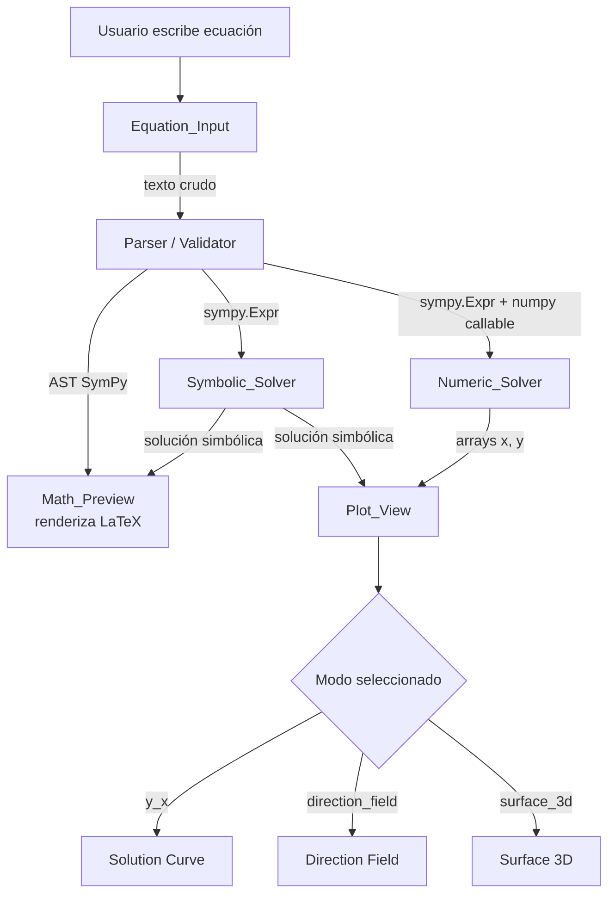

# Design Document — ODE Calculator

## Overview

ODE Calculator es una aplicación de escritorio Python para la resolución y visualización de ecuaciones diferenciales de primer orden (EDOs). Está orientada a estudiantes e ingenieros que necesitan una herramienta interactiva capaz de:

- Aceptar EDOs escritas en sintaxis Python/SymPy.
- Previsualizarlas con renderizado tipográfico matemático en tiempo real.
- Resolverlas de forma simbólica (SymPy `dsolve`) y numérica (SciPy `solve_ivp`).
- Visualizar la solución en tres modos: gráfica de solución `y(x)`, campo de pendientes (Direction Field) y superficie 3D `z = f(x, y)`.
- Proporcionar atajos de teclado, una barra de símbolos y una biblioteca de ejercicios predefinidos.

La interfaz se construye sobre `tkinter` estándar de Python con `ttk` (themed widgets) y `ttk.Style` para una apariencia moderna sin dependencias externas de UI, incrustando figuras de Matplotlib mediante `FigureCanvasTkAgg`.

---

## Architecture

### Vista general

```
┌─────────────────────────────────────────────────────────────┐
│                        ODE_Calculator (App)                  │
│  ┌──────────────────────┐   ┌────────────────────────────┐  │
│  │    Left Panel        │   │       Right Panel          │  │
│  │                      │   │                            │  │
│  │  Symbol_Toolbar      │   │  Math_Preview              │  │
│  │  Equation_Input      │   │  ─────────────────────     │  │
│  │  Condition_Panel     │   │  Plot_View                 │  │
│  │  [Solve Buttons]     │   │    [Tab: y(x) | DF | 3D]  │  │
│  │  Exercise_Library    │   │    [View presets (3D)]     │  │
│  └──────────────────────┘   └────────────────────────────┘  │
│  ─────────────────────────────────────────────────────────  │
│                        Status Bar                            │
└─────────────────────────────────────────────────────────────┘
```

### Flujo de datos principal



### Capas de la aplicación

| Capa | Responsabilidad |
|------|----------------|
| **UI Layer** (`tkinter` + `ttk`) | Widgets, layout, eventos de usuario, atajos de teclado |
| **Controller** (`app.py`) | Orquesta eventos entre UI y módulos de lógica |
| **Math Engine** | Parsing, validación, solución simbólica y numérica, generación de pasos |
| **Visualization** | Generación de figuras Matplotlib en los tres modos |
| **Data** | Ejercicios predefinidos (Python), estado de sesión |

---

## Components and Interfaces

### 1. `App` (controlador principal)

**Archivo**: `app.py`

Hereda de `tk.Tk`. Crea el layout raíz con `ttk.PanedWindow`, instancia todos los componentes, registra los atajos de teclado globales y actúa como bus de eventos entre los módulos. Aplica estilos con `ttk.Style` al inicio para definir colores, fuentes y apariencia de todos los widgets.

```python
class App(tk.Tk):
    def __init__(self) -> None: ...
    def _configure_styles(self) -> None: ...   # ttk.Style setup
    def _bind_shortcuts(self) -> None: ...
    def _on_solve_symbolic(self) -> None: ...
    def _on_solve_numeric(self) -> None: ...
    def _on_equation_changed(self, text: str) -> None: ...
    def _on_mode_changed(self, mode: PlotMode) -> None: ...
```

---

### 2. `EquationInput`

**Archivo**: `ui/equation_input.py`

Widget `ttk.Frame` que contiene un `tk.Text` de una línea (o `ttk.Entry`). Emite un callback `on_change(text: str)` en cada pulsación de tecla. Gestiona la inserción de tokens mediante atajos y botones de la `SymbolToolbar`.

```python
class EquationInput(ttk.Frame):
    def insert_token(self, token: str, place_cursor_inside: bool = False) -> None: ...
    def get_text(self) -> str: ...
    def set_text(self, text: str) -> None: ...
    # Callback
    on_change: Callable[[str], None]
```

**Atajos de teclado** (ligados cuando el widget tiene foco):

| Atajo | Token insertado | Cursor dentro |
|-------|----------------|---------------|
| `Ctrl+D` | `dy/dx` | No |
| `Ctrl+I` | `Integral` | No |
| `Ctrl+Shift+I` | `oo` | No |
| `Ctrl+E` | `exp()` | Sí |
| `Ctrl+Shift+S` | `sqrt()` | Sí |
| `Ctrl+P` | `pi` | No |

---

### 3. `SymbolToolbar`

**Archivo**: `ui/symbol_toolbar.py`

Barra horizontal de `ttk.Button` con los mismos tokens que los atajos de teclado. Al hacer clic, llama a `EquationInput.insert_token(...)`.

```python
class SymbolToolbar(ttk.Frame):
    def __init__(self, master, equation_input: EquationInput) -> None: ...
```

---

### 4. `ConditionPanel`

**Archivo**: `ui/condition_panel.py`

`ttk.LabelFrame` con campos `ttk.Entry` para: `x₀`, `y₀`, `x_min`, `x_max`, `y_min`, `y_max`. Expone un dataclass de salida `SolverConditions`.

```python
@dataclass
class SolverConditions:
    x0: float | None
    y0: float | None
    x_min: float
    x_max: float
    y_min: float | None
    y_max: float | None

class ConditionPanel(ttk.LabelFrame):
    def get_conditions(self) -> SolverConditions: ...
    def set_conditions(self, cond: SolverConditions) -> None: ...
```

---

### 5. `MathPreview`

**Archivo**: `ui/math_preview.py`

`ttk.Frame` que incrusta una pequeña figura Matplotlib (`FigureCanvasTkAgg`) con tamaño fijo. Usa `matplotlib.mathtext` para renderizar la cadena LaTeX producida por `sympy.latex(expr)`. Se actualiza en tiempo real.

```python
class MathPreview(ttk.Frame):
    def render(self, latex_str: str) -> None: ...
    def show_placeholder(self) -> None: ...  # dy/dx = f(x, y)
```

---

### 6. `Parser` / `Validator`

**Archivo**: `math_engine/parser.py`

Convierte el texto crudo del `EquationInput` en una expresión SymPy. Separa el lado derecho de la EDO (la `f(x, y)`) para su uso en el solver numérico y en la visualización.

```python
def parse_ode(text: str) -> ParseResult:
    """
    Retorna ParseResult con:
      - rhs: sympy.Expr  (lado derecho dy/dx = rhs)
      - latex_str: str   (cadena LaTeX para Math_Preview)
      - error: str | None
    """

@dataclass
class ParseResult:
    rhs: sp.Expr | None
    latex_str: str
    error: str | None
```

Estrategia de parsing:
1. Normalizar texto: `y'` → `Derivative(y(x), x)`, `dy/dx` → idem.
2. Separar por `=`; tomar RHS.
3. Llamar `sp.sympify(rhs_str, locals={'x': x, 'y': y(x), ...})`.
4. Si falla, capturar excepción y poblar `error`.

---

### 7. `SymbolicSolver`

**Archivo**: `math_engine/symbolic_solver.py`

```python
def solve_symbolic(
    rhs: sp.Expr,
    conditions: SolverConditions | None = None
) -> SymbolicResult:
    """
    Usa sympy.dsolve para obtener solución general.
    Si conditions está presente, aplica sympy.solve para obtener
    la constante C1 (solución particular).
    """

@dataclass
class SymbolicResult:
    general_solution: sp.Eq | None
    particular_solution: sp.Eq | None
    latex_general: str
    latex_particular: str
    error: str | None
    ode_type: str | None   # 'separable', 'linear', etc.
```

---

### 8. `NumericSolver`

**Archivo**: `math_engine/numeric_solver.py`

```python
def solve_numeric(
    rhs: sp.Expr,
    conditions: SolverConditions,
    n_points: int = 500
) -> NumericResult:
    """
    Lambdifica rhs con sympy.lambdify y llama scipy.integrate.solve_ivp.
    """

@dataclass
class NumericResult:
    x_arr: np.ndarray | None
    y_arr: np.ndarray | None
    success: bool
    message: str
```

---

### 9. `PlotView`

**Archivo**: `ui/plot_view.py`

`ttk.Frame` que incrusta un `FigureCanvasTkAgg` de Matplotlib de tamaño completo en el panel derecho. Contiene un selector de modo (`ttk.Notebook` o `ttk.Combobox`) y los botones de vista predefinida para el modo 3D.

```python
class PlotMode(str, Enum):
    SOLUTION = "y(x)"
    DIRECTION_FIELD = "Direction Field"
    SURFACE_3D = "Surface 3D"

class PlotView(ttk.Frame):
    def plot_solution(
        self,
        symbolic: SymbolicResult | None,
        numeric: NumericResult | None,
        conditions: SolverConditions
    ) -> None: ...

    def plot_direction_field(
        self,
        rhs: sp.Expr,
        conditions: SolverConditions,
        solution_curve: NumericResult | None = None
    ) -> None: ...

    def plot_surface_3d(
        self,
        rhs: sp.Expr,
        conditions: SolverConditions
    ) -> None: ...

    def set_3d_view(self, elev: float, azim: float) -> None: ...
```

**Vistas predefinidas 3D**:

| Botón | `elev` | `azim` |
|-------|--------|--------|
| Frontal | 0° | 0° |
| Lateral | 0° | 90° |
| Isométrica | 30° | 45° |

---

### 10. `StepByStepPanel`

**Archivo**: `ui/step_by_step_panel.py`

`ttk.Frame` con un `tk.Text` de solo lectura con scroll vertical. Renderiza cada paso como una figura Matplotlib incrustada (para las expresiones matemáticas con `mathtext`) seguida de texto explicativo. Incluye botón "Copiar pasos" que exporta texto ASCII al portapapeles.

```python
@dataclass
class SolutionStep:
    number: int
    operation: str          # Nombre de la operación (e.g., "Separar variables")
    latex_expr: str         # Expresión en LaTeX para renderizar
    justification: str      # Explicación en texto plano
    detail: str | None      # Sub-detalle atómico (e.g., "(-) × (-) = (+)")

class StepByStepPanel(ttk.Frame):
    def display_steps(self, steps: list[SolutionStep]) -> None: ...
    def clear(self) -> None: ...
    def copy_to_clipboard(self) -> None: ...  # Exporta pasos como texto ASCII
```

**Estructura visual de cada paso:**
```
┌─────────────────────────────────────────────────┐
│  Paso 3: Integrar ambos lados                   │
│  ┌─────────────────────────────────────────┐    │
│  │   ∫(1/y)dy = ∫x dx          [mathtext]  │    │
│  │   ln|y| = x²/2 + C          [mathtext]  │    │
│  └─────────────────────────────────────────┘    │
│  Regla: ∫(1/u)du = ln|u| + C                   │
│  Detalle: constante de integración C añadida     │
│           al lado derecho                        │
└─────────────────────────────────────────────────┘
```

---

### 11. `ExerciseLibrary`

**Archivo**: `ui/exercise_library.py` + `data/exercises.py`

`ttk.Frame` con un `ttk.Treeview` o `tk.Listbox` con scroll para listar ejercicios. Al seleccionar uno, llama al controlador para cargar ecuación y condiciones.

```python
@dataclass
class Exercise:
    id: str
    ode_type: str          # 'separable', 'linear', 'exact', 'homogeneous', 'bernoulli', 'application'
    name: str
    equation_text: str     # Sintaxis Python/SymPy
    latex_str: str         # Para renderizado tipográfico en la lista
    description: str
    initial_conditions: SolverConditions | None

class ExerciseLibrary(ttk.Frame):
    def on_select(self, exercise: Exercise) -> None: ...  # callback al App
```

---

### 12. `StatusBar`

**Archivo**: `ui/status_bar.py`

```python
class StatusBar(ttk.Frame):
    def set_status(self, message: str, level: Literal["info", "error", "warning"] = "info") -> None: ...
    def show_spinner(self) -> None: ...
    def hide_spinner(self) -> None: ...
```

---

### 13. `ExportManager` *(Opcional — Requirement 11)*

**Archivo**: `ui/export_manager.py`

Requiere `Pillow ≥10.0`. Abre un `tkinter.filedialog.asksaveasfilename` con filtros PNG/JPEG/PDF. Usa `matplotlib.backends.backend_pdf.PdfPages` para PDF y `figure.savefig(..., dpi=300)` para imágenes.

```python
def export_figure(fig: Figure) -> None:
    """Abre diálogo de guardado y exporta con DPI=300."""
```

---

## Data Models

### `ParseResult`

```python
@dataclass
class ParseResult:
    rhs: sp.Expr | None       # Expresión SymPy del lado derecho
    latex_str: str            # Cadena LaTeX completa de la ecuación
    error: str | None         # Mensaje de error si el parsing falla
```

### `SolverConditions`

```python
@dataclass
class SolverConditions:
    x0: float | None = None
    y0: float | None = None
    x_min: float = -5.0
    x_max: float = 5.0
    y_min: float | None = None   # None → auto-escala
    y_max: float | None = None
```

### `SolutionStep` y `StepByStepResult`

```python
@dataclass
class SolutionStep:
    number: int
    operation: str       # e.g., "Identificar tipo de EDO", "Separar variables"
    latex_expr: str      # Expresión LaTeX del resultado de este paso
    justification: str   # Explicación textual
    detail: str | None   # Sub-detalle atómico (e.g., "(-1)×(-3) = +3")

@dataclass
class StepByStepResult:
    steps: list[SolutionStep]
    ode_type: str          # Tipo identificado
    ascii_text: str        # Representación ASCII completa para copiar al portapapeles
```

### `SymbolicResult`

```python
@dataclass
class SymbolicResult:
    general_solution: sp.Eq | None
    particular_solution: sp.Eq | None
    latex_general: str
    latex_particular: str
    error: str | None
    ode_type: str | None
    step_by_step: StepByStepResult | None   # Pasos detallados de resolución
```

### `NumericResult`

```python
@dataclass
class NumericResult:
    x_arr: np.ndarray | None
    y_arr: np.ndarray | None
    success: bool
    message: str
```

### `Exercise`

```python
@dataclass
class Exercise:
    id: str
    ode_type: str
    name: str
    equation_text: str
    latex_str: str
    description: str
    initial_conditions: SolverConditions | None
```

### Estado de sesión (`AppState`)

```python
@dataclass
class AppState:
    current_equation_text: str = ""
    last_parse_result: ParseResult | None = None
    symbolic_result: SymbolicResult | None = None
    numeric_result: NumericResult | None = None
    conditions: SolverConditions = field(default_factory=SolverConditions)
    plot_mode: PlotMode = PlotMode.SOLUTION
    step_by_step_visible: bool = True
```

---

## Correctness Properties

*A property is a characteristic or behavior that should hold true across all valid executions of a system — essentially, a formal statement about what the system should do. Properties serve as the bridge between human-readable specifications and machine-verifiable correctness guarantees.*

### Property 1: Round-trip de parsing y renderizado LaTeX

*Para cualquier* texto de ecuación diferencial de primer orden válido en sintaxis Python/SymPy, parsearlo a una expresión SymPy y convertir esa expresión a cadena LaTeX con `sympy.latex` SHALL producir una cadena LaTeX no vacía. A su vez, esa cadena LaTeX debe corresponder a una expresión matemáticamente equivalente a la original.

**Validates: Requirements 1.1, 1.4, 2.1**

---

### Property 2: Rechazo de entradas inválidas

*Para cualquier* cadena que no represente una EDO de primer orden válida — incluyendo cadenas vacías, cadenas compuestas solo de espacios en blanco, expresiones sin `=`, ecuaciones de segundo orden o superior, y texto arbitrario — el parser SHALL retornar un `ParseResult` con `rhs = None` y `error ≠ None`.

**Validates: Requirements 1.3**

---

### Property 3: Solución simbólica satisface la EDO original

*Para cualquier* EDO de primer orden de los tipos separable, lineal, exacta, homogénea o Bernoulli que sea resuelta exitosamente por `SymbolicSolver`, al sustituir la solución general obtenida de vuelta en la ecuación original y simplificar con SymPy, el resultado SHALL ser idénticamente cero (verificación de que la solución es correcta).

**Validates: Requirements 3.1, 3.2, 3.5**

---

### Property 4: Solución particular satisface condiciones iniciales

*Para cualquier* EDO resoluble simbólicamente y cualquier par de condiciones iniciales `(x₀, y₀)`, la solución particular calculada por `SymbolicSolver` al evaluarse en `x = x₀` SHALL producir un valor igual a `y₀` dentro de una tolerancia de ε < 1×10⁻⁶.

**Validates: Requirements 3.3**

---

### Property 5: Solución numérica y cobertura mínima de puntos

*Para cualquier* ejecución exitosa del `NumericSolver` con condiciones iniciales `(x₀, y₀)` sobre un intervalo `[x_min, x_max]` válido:
- El array `x_arr` SHALL contener al menos 500 elementos.
- El primer punto SHALL satisfacer `|x_arr[0] − x₀| < 1×10⁻⁹` e `|y_arr[0] − y₀| < 1×10⁻⁶`.

*(Las propiedades anteriores sobre "densidad mínima de puntos" y "pasa por la condición inicial" se consolidan aquí en una sola porque ambas dependen del mismo resultado `NumericResult` y se verifican conjuntamente.)*

**Validates: Requirements 4.1, 4.3**

---

### Property 6: Integridad del catálogo de ejercicios

*Para cualquier* ejercicio en la `Exercise_Library`:
- El catálogo completo SHALL contener al menos 15 ejercicios.
- Cada ejercicio SHALL tener `name`, `latex_str` y `description` como cadenas no vacías.
- El campo `equation_text` SHALL ser parseable sin error por `parse_ode`.
- Al cargar cualquier ejercicio, el texto del `Equation_Input` SHALL coincidir con `exercise.equation_text` y, si el ejercicio tiene condiciones iniciales, el `ConditionPanel` SHALL reflejar exactamente esos valores.

*(Las propiedades 7.1, 7.2 y 7.3 del prework se consolidan aquí porque todas verifican invariantes del mismo conjunto de datos y la carga del ejercicio es un round-trip sobre ese mismo dato.)*

**Validates: Requirements 7.1, 7.2, 7.3, 7.5**

---

### Property 7: Inserción de tokens mediante atajos de teclado

*Para cualquier* atajo de teclado definido en la tabla de atajos y cualquier estado previo del `EquationInput`, al activar el atajo:
- El token correspondiente SHALL aparecer en el texto del `EquationInput`.
- Si el token contiene paréntesis (`exp()`, `sqrt()`), la posición del cursor SHALL estar ubicada entre los paréntesis del token insertado.

**Validates: Requirements 6.1, 6.2**

---

### Property 8: Direction Field usa intervalo por defecto cuando faltan condiciones

*Para cualquier* activación del modo Direction Field en la que el `ConditionPanel` no contenga valores explícitos de `x_min`, `x_max`, `y_min` e `y_max`, la cuadrícula de pendientes SHALL calcularse exactamente sobre el intervalo `[−5, 5] × [−5, 5]`.

**Validates: Requirements 5.9**

---

### Property 9: Resolución mínima y etiquetas en visualizaciones

*Para cualquier* llamada a `plot_surface_3d` con una función `f(x, y)` válida e intervalo definido:
- La cuadrícula de evaluación SHALL tener al menos 50 puntos en cada eje (forma `(N, M)` con N ≥ 50 y M ≥ 50).
- Los ejes de la figura SHALL estar etiquetados con `x`, `y` y `z = f(x,y)`.

*Para cualquier* llamada a `plot_solution` o `plot_direction_field` con una solución válida:
- Los ejes 2D de la figura SHALL tener etiquetas no vacías en `xlabel` e `ylabel`.

*(Las propiedades de resolución 50×50 y de etiquetado de ejes se consolidan en una sola porque ambas son invariantes de estructura de la figura generada y se verifican en el mismo objeto.)*

**Validates: Requirements 5.1, 5.10, 5.11**

---

## Error Handling

### Errores de parsing

- Capturar `SympifyError`, `TypeError`, `ValueError` en `parser.py`.
- Poblar `ParseResult.error` con un mensaje descriptivo en español.
- La UI muestra el mensaje en la `StatusBar` con nivel `"error"`.
- El `Math_Preview` muestra el placeholder en lugar del renderizado.

### Errores del solver simbólico

- `sympy.dsolve` puede lanzar `NotImplementedError` para EDOs no reconocidas.
- Si `dsolve` falla, `SymbolicResult.error` se popula y se notifica al usuario.
- Se ofrece automáticamente la solución numérica como alternativa (llamada al `NumericSolver`).

### Errores del solver numérico

- Si `solve_ivp` retorna `success = False`, `NumericResult.success = False` y `message` contiene el motivo.
- La UI muestra el mensaje y sugiere ajustar el intervalo o las condiciones iniciales.

### Librería no instalada al inicio

- `app.py` verifica importaciones críticas en un bloque `try/except ImportError` antes de construir la UI.
- Si falta alguna, muestra un `tkinter.messagebox.showerror` con el nombre del paquete y el comando `pip install` correspondiente, luego termina.

### Operaciones lentas (> 2 segundos)

- El `App` ejecuta los solvers en un hilo secundario (`threading.Thread`).
- Antes de lanzar el hilo activa `StatusBar.show_spinner()`.
- Al completarse (con éxito o error) el hilo llama `app.after(0, callback)` para actualizar la UI en el hilo principal.

### Exportación (opcional)

- Si `Pillow` no está instalado al intentar exportar, se muestra un error descriptivo con instrucciones de instalación en lugar de abortar la aplicación.

---

## Testing Strategy

### Enfoque dual: tests unitarios + tests basados en propiedades

Los tests siguen una estrategia de dos niveles complementarios:

- **Tests unitarios** (pytest): verifican ejemplos concretos, casos borde y contratos de interfaces.
- **Tests basados en propiedades** (Hypothesis): validan invariantes universales sobre espacios de entrada amplios.

### Librería de property-based testing

Se utilizará **[Hypothesis](https://hypothesis.readthedocs.io/)** (≥6.100), la librería estándar de PBT para Python.

```
hypothesis>=6.100
```

Cada test de propiedad se configura con un mínimo de **100 iteraciones** (`settings(max_examples=100)`).

---

### Tests unitarios

#### `math_engine/parser.py`
- Parsear `dy/dx = x + y` retorna `rhs = x + y(x)` y `error = None`.
- Parsear `y' = sin(x)` retorna expresión correcta.
- Parsear cadena vacía retorna `error ≠ None`.
- Parsear expresión sin `=` retorna `error ≠ None`.
- Parsear EDO de segundo orden retorna `error ≠ None`.
- Todas las funciones estándar (`sin`, `cos`, `tan`, `exp`, `log`, `sqrt`) se parsean sin error.

#### `math_engine/symbolic_solver.py`
- EDO separable canónica (`dy/dx = y`) tiene solución `y = C1 * exp(x)`.
- EDO lineal (`dy/dx = x`) tiene solución `y = x²/2 + C1`.
- Con condiciones iniciales `(0, 1)` en `dy/dx = y`, la particular es `y = exp(x)`.
- EDO no resoluble retorna `SymbolicResult.error ≠ None`.

#### `math_engine/numeric_solver.py`
- Solución numérica de `dy/dx = y` con `(0, 1)` en `[0, 2]` aproxima `y = exp(x)` con error < 1e-4.
- `x_arr` tiene ≥ 500 puntos.
- Intervalo inválido (`x_min > x_max`) retorna `success = False`.

#### `ui/equation_input.py` (con `pytest-tk` o tests headless)
- `insert_token("exp()", place_cursor_inside=True)` coloca cursor entre paréntesis.
- `insert_token("pi")` no mueve el cursor dentro.

#### `data/exercises.py`
- La biblioteca contiene ≥ 15 ejercicios.
- Cada tipo requerido tiene el número mínimo de ejercicios.
- Cada `Exercise` tiene `equation_text` parseable sin error.

---

### Tests basados en propiedades (Hypothesis)

Cada propiedad del documento se implementa como un único test Hypothesis. El formato de etiqueta en el comentario de cada test es:
`Feature: ode-calculator, Property N: <texto breve>`

```python
# conftest.py — estrategias Hypothesis compartidas
from hypothesis import given, settings, strategies as st

# Estrategias base
valid_ode_texts   = st.sampled_from([...])   # ecuaciones válidas conocidas + generadas
invalid_ode_texts = st.one_of(
    st.just(""),
    st.text(max_size=5).filter(lambda s: '=' not in s),
    st.just("d2y/dx2 = y"),   # segundo orden
)
solvable_odes     = st.sampled_from([...])   # (rhs_expr, tipo) de los 5 tipos
numeric_odes      = st.sampled_from([...])   # (rhs_callable, x0, y0, x_min, x_max)
```

```python
# test_properties.py

@settings(max_examples=100)
@given(equation_text=valid_ode_texts)
def test_property_1_parse_roundtrip(equation_text):
    # Feature: ode-calculator, Property 1: Round-trip de parsing y renderizado LaTeX
    result = parse_ode(equation_text)
    assert result.rhs is not None
    latex = result.latex_str
    assert isinstance(latex, str) and len(latex) > 0

@settings(max_examples=100)
@given(text=invalid_ode_texts)
def test_property_2_invalid_input_rejected(text):
    # Feature: ode-calculator, Property 2: Rechazo de entradas inválidas
    result = parse_ode(text)
    assert result.rhs is None
    assert result.error is not None and len(result.error) > 0

@settings(max_examples=100)
@given(ode=solvable_odes)
def test_property_3_symbolic_solution_satisfies_ode(ode):
    # Feature: ode-calculator, Property 3: Solución simbólica satisface la EDO original
    rhs, _ = ode
    sol = solve_symbolic(rhs)
    assert sol.general_solution is not None
    # Verificar: sustituir en ODE y simplificar da 0
    ...

@settings(max_examples=100)
@given(
    ode=solvable_odes,
    x0=st.floats(-3.0, 3.0),
    y0=st.floats(-3.0, 3.0),
)
def test_property_4_particular_solution_satisfies_ic(ode, x0, y0):
    # Feature: ode-calculator, Property 4: Solución particular satisface condiciones iniciales
    rhs, _ = ode
    cond = SolverConditions(x0=x0, y0=y0)
    sol = solve_symbolic(rhs, cond)
    if sol.particular_solution is not None:
        evaluated = float(sol.particular_solution.rhs.subs(x, x0))
        assert abs(evaluated - y0) < 1e-6

@settings(max_examples=100)
@given(entry=numeric_odes)
def test_property_5_numeric_solution_coverage_and_ic(entry):
    # Feature: ode-calculator, Property 5: Solución numérica y cobertura mínima de puntos
    rhs, x0, y0, x_min, x_max = entry
    cond = SolverConditions(x0=x0, y0=y0, x_min=x_min, x_max=x_max)
    result = solve_numeric(rhs, cond)
    assert result.success
    assert len(result.x_arr) >= 500
    assert abs(result.x_arr[0] - x0) < 1e-9
    assert abs(result.y_arr[0] - y0) < 1e-6

@settings(max_examples=100)
@given(exercise=st.sampled_from(load_exercises()))
def test_property_6_exercise_catalog_integrity(exercise):
    # Feature: ode-calculator, Property 6: Integridad del catálogo de ejercicios
    exercises = load_exercises()
    assert len(exercises) >= 15
    assert exercise.name and exercise.latex_str and exercise.description
    parse_result = parse_ode(exercise.equation_text)
    assert parse_result.error is None

@settings(max_examples=100)
@given(shortcut=st.sampled_from(list(SHORTCUT_MAP.items())))
def test_property_7_shortcut_inserts_token(shortcut):
    # Feature: ode-calculator, Property 7: Inserción de tokens mediante atajos de teclado
    key, (token, cursor_inside) = shortcut
    eq_input = EquationInput.__new__(EquationInput)  # instancia headless de prueba
    eq_input.insert_token(token, place_cursor_inside=cursor_inside)
    assert token.replace("()", "") in eq_input.get_text()
    if cursor_inside:
        # el cursor debe estar entre los paréntesis
        pos = eq_input.get_cursor_position()
        idx = eq_input.get_text().index("(") + 1
        assert pos == idx

@settings(max_examples=100)
@given(rhs=st.sampled_from(valid_rhs_exprs))
def test_property_8_direction_field_default_interval(rhs):
    # Feature: ode-calculator, Property 8: Direction Field usa intervalo por defecto cuando faltan condiciones
    cond = SolverConditions()  # sin x_min/x_max/y_min/y_max explícitos
    result_bounds = compute_direction_field_bounds(rhs, cond)
    assert result_bounds == (-5.0, 5.0, -5.0, 5.0)

@settings(max_examples=100)
@given(
    rhs=st.sampled_from(valid_rhs_exprs),
    cond=st.builds(SolverConditions, x_min=st.floats(-10, 0), x_max=st.floats(1, 10),
                   y_min=st.floats(-10, 0), y_max=st.floats(1, 10)),
)
def test_property_9_surface_3d_resolution_and_labels(rhs, cond):
    # Feature: ode-calculator, Property 9: Resolución mínima y etiquetas en visualizaciones
    fig, ax = create_surface_3d(rhs, cond)
    X, Y = get_meshgrid_from_figure(fig)
    assert X.shape[0] >= 50 and X.shape[1] >= 50
    assert ax.get_xlabel() != "" and ax.get_ylabel() != "" and ax.get_zlabel() != ""
```

---

### Estructura de archivos de tests

```
tests/
├── test_parser.py
├── test_symbolic_solver.py
├── test_numeric_solver.py
├── test_exercises.py
├── test_properties.py          ← todos los tests Hypothesis
└── conftest.py                 ← estrategias Hypothesis compartidas
```

---

## Project File Structure

```
ode-calculator/
├── app.py                          # Punto de entrada, App (tk.Tk root)
├── requirements.txt                # Dependencias pinneadas
├── README.md
│
├── math_engine/
│   ├── __init__.py
│   ├── parser.py                   # parse_ode(), ParseResult
│   ├── symbolic_solver.py          # solve_symbolic(), SymbolicResult
│   ├── numeric_solver.py           # solve_numeric(), NumericResult
│   └── step_generator.py           # generate_steps(), StepByStepResult, SolutionStep
│
├── ui/
│   ├── __init__.py
│   ├── equation_input.py           # EquationInput (ttk.Frame)
│   ├── symbol_toolbar.py           # SymbolToolbar (ttk.Frame)
│   ├── condition_panel.py          # ConditionPanel (ttk.LabelFrame), SolverConditions
│   ├── math_preview.py             # MathPreview (ttk.Frame + FigureCanvasTkAgg)
│   ├── step_by_step_panel.py       # StepByStepPanel (ttk.Frame + tk.Text)
│   ├── plot_view.py                # PlotView (ttk.Frame), PlotMode
│   ├── exercise_library.py         # ExerciseLibrary (ttk.Frame + ttk.Treeview)
│   ├── status_bar.py               # StatusBar (ttk.Frame)
│   └── export_manager.py           # ExportManager (opcional, Req. 11)
│
├── data/
│   ├── __init__.py
│   └── exercises.py                # Lista de Exercise (≥15 ejercicios)
│
└── tests/
    ├── __init__.py
    ├── conftest.py
    ├── test_parser.py
    ├── test_symbolic_solver.py
    ├── test_numeric_solver.py
    ├── test_step_generator.py
    ├── test_exercises.py
    └── test_properties.py
```

### `requirements.txt` (dependencias pinneadas)

```
sympy==1.13.1
scipy==1.13.1
matplotlib==3.9.2
numpy==1.26.4
hypothesis==6.112.0
pytest==8.3.3
# tkinter viene incluido en la biblioteca estándar de Python (no requiere instalación)
# Opcional (Requirement 11):
# Pillow==10.4.0
```

> **Nota**: Se eliminó `customtkinter` y `ttkthemes`. La UI usa únicamente `tkinter` + `ttk` de la biblioteca estándar de Python, lo que elimina dependencias externas de UI, simplifica la instalación y garantiza compatibilidad nativa en Windows, macOS y Linux sin configuración adicional. El estilo moderno se logra mediante `ttk.Style` con temas built-in (`clam`, `alt`) y personalización de colores/fuentes.
